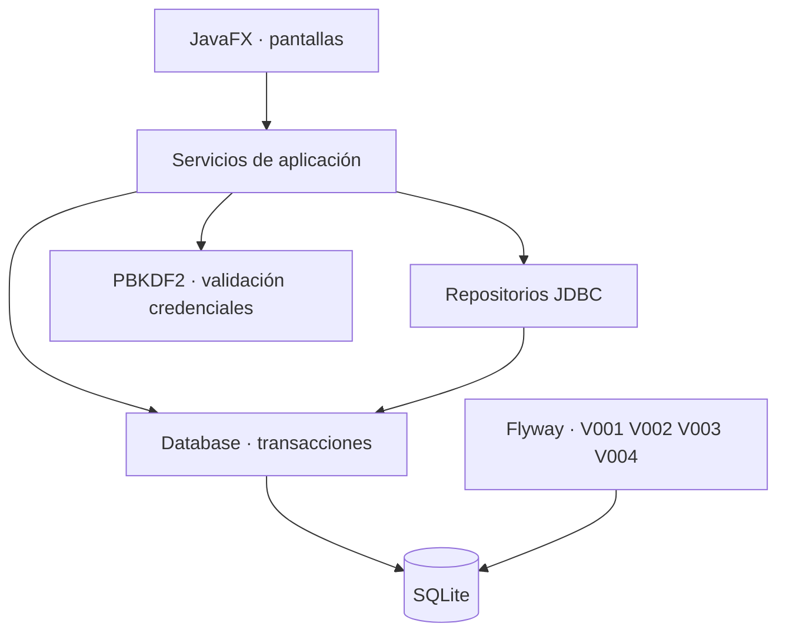
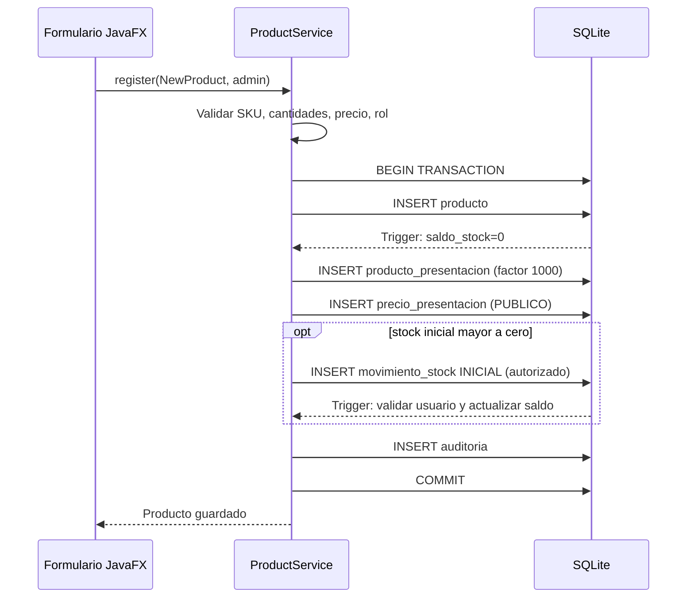

# Arquitectura de implementación · Hito 01

## Responsabilidades

**Principio clave:** la interfaz no ejecuta SQL, los repositorios no manipulan el estado visual, los servicios administran las transacciones y validan reglas. SQLite impone integridad adicional mediante constraints y triggers.

## Ciclo de arranque

1. `Main` lanza JavaFX.
2. `InventarioApp` obtiene ruta de datos.
3. `Database.initialize()` crea directorio y ejecuta migraciones Flyway en una base **nueva**.
4. `AuthService.requiresBootstrap()` detecta si hay cuentas.
5. Si es la primera ejecución, solicita crear administrador (sin claves predeterminadas).
6. Desde ese momento el sistema exige login.
7. Al cerrar sesión, descarta `Session` y muestra el login.

## Registro de producto

Si falla cualquier paso, la operación se revierte completamente. **Nunca** se edita el saldo físico desde el formulario.

## Reglas técnicas

- Dinero: `BigDecimal` en Java y enteros escalados en SQL (micro y centavos, según columna).
- Unidades: milésimas, validadas por `unidad_medida.decimales_permitidos`.
- DB local y fuera del directorio del código fuente.
- SQL siempre parametrizado mediante `PreparedStatement`.
- Permisos de ajustes iniciales protegidos en SQLite además de la capa Java.
- Facturación e impresora serán integraciones externas independientes en próximas etapas.

## Límites y temas abiertos

- Esta entrega no implementa la anulación/rectificación de comprobantes ni devoluciones.
- Falta respaldo y recuperación, así como una estrategia de actualización en producción.
- Falta demostrar una compilación con dependencias en Windows y realizar pruebas de interfaz de punta a punta.
- Se deben registrar acciones administrativas adicionales y permisos de catálogo cuando se implementen pantallas de edición.
